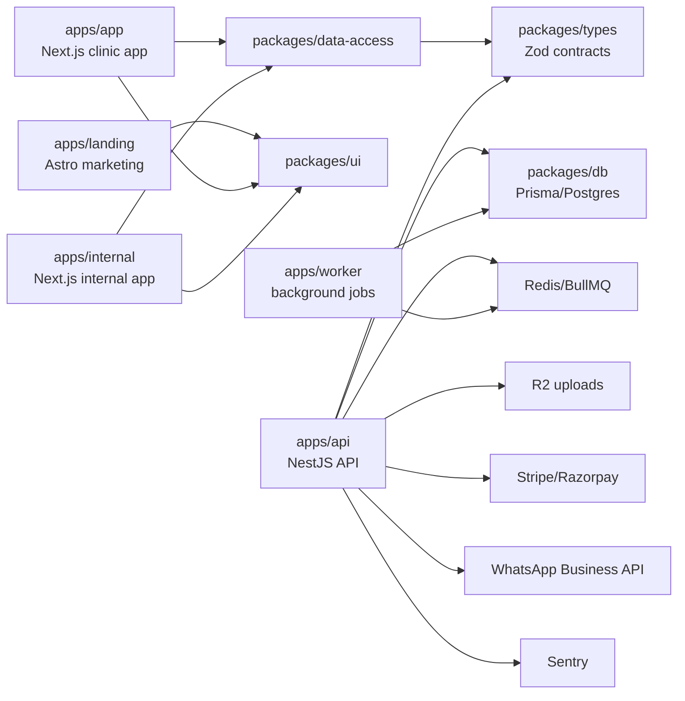

# Architecture

Docita is a Turborepo monorepo for a healthcare product handling PHI.

## Boundaries

- `packages/types` owns Zod request/response contracts.
- `packages/data-access` owns API clients, query keys, response parsing, and React Query hooks.
- `packages/ui` owns presentational primitives only.
- `packages/db` owns Prisma schema, generated client, and DB scripts.
- API controllers stay thin; services/use-cases own orchestration; repositories own persistence.
- Frontend route files compose feature shells; feature hooks/components own app behavior.
