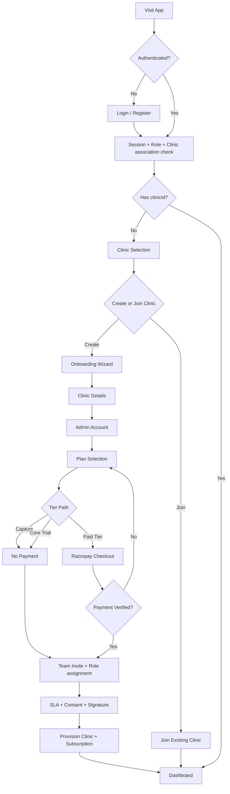
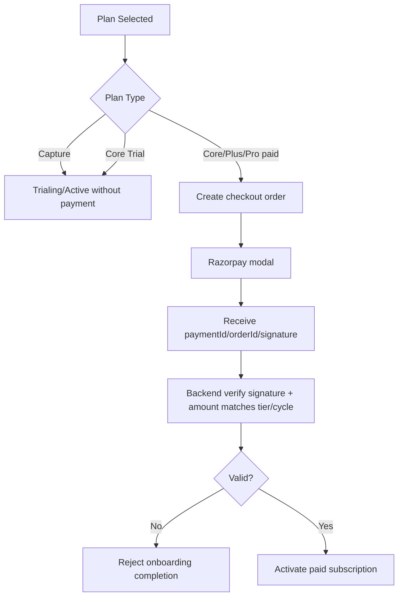

# User Flow Blueprint (2026-03-06)

This document defines the recommended product flow for Docita from authentication through onboarding, billing, role management, and core feature usage.

## 1) High-Level Journey

## 2) Access Control Rules

1. Unauthenticated users:
- Can access: login/register pages.
- Cannot access: onboarding, clinic-selection, dashboard, feature pages.

2. Authenticated users without clinic association (`clinicId` is null):
- Must go to `clinic-selection`.
- Can choose:
- Create clinic (onboarding).
- Join clinic (code/email).

3. Authenticated users with clinic association:
- Skip onboarding and clinic-selection.
- Go to dashboard.

4. Enterprise onboarding:
- Treated as sales-assisted path in onboarding.
- User gets direct `Contact Sales` action.
- No self-serve checkout in onboarding for Enterprise.

## 3) Onboarding Flow (Target)

### Step 1: Clinic Details
- Capture basic clinic identity and contact.
- Validate required fields before continuing.

### Step 2: Admin Account
- Create clinic owner account.
- Owner is admin-level user for clinic setup.

### Step 3: Plan Selection
- Show detailed plan cards + dynamic estimator.
- Core supports optional 14-day trial.
- Paid self-serve tiers open Razorpay directly.
- Enterprise routes to Contact Sales.

### Step 4: Team Invite + Role Setup
- Invite members with explicit role descriptions:
- Doctor: clinical workflows.
- Receptionist: front desk and scheduling.
- Admin Doctor: clinical + admin oversight.
- Show "Members to be added" summary list.

### Step 5: Compliance
- SLA acceptance.
- Privacy and data processing acceptance.
- Signature upload.
- Consent policy setup.

### Completion
- Backend provisions clinic, owner user, subscription status.
- Paid tiers require verified payment metadata and amount check.

## 4) Payment and Billing Flow

Rules:
1. Verification must include signature and amount validation.
2. Price must be derived server-side from selected tier + billing cycle.
3. Frontend-submitted plan price is advisory only.

## 5) Role and Permission Governance

### Suggested role baseline
1. `ADMIN`
- Clinic owner/admin.
- Full clinic configuration and member management.

2. `ADMIN_DOCTOR`
- Clinical + delegated admin capabilities.
- Can manage team and operational settings (as configured).

3. `DOCTOR`
- Clinical workflows only.

4. `RECEPTIONIST`
- Scheduling/front-desk and limited operational actions.

### Role assignment lifecycle
1. During onboarding team invite, role chosen with role description.
2. After onboarding, owner/admin can change role/permissions in settings.
3. Audit trail should record role changes and permission updates.

## 6) Feature Map by Journey Phase

### Phase A: Access
- Login/Register
- Session validation
- Clinic association guard

### Phase B: Setup
- Onboarding
- Plan selection + checkout
- Consent/legal setup
- Team invitations

### Phase C: Core operations
- Dashboard
- Patients
- Appointments
- Consultation
- Prescriptions
- Invoices
- Documents

### Phase D: Growth and control
- Analytics
- WhatsApp workflows
- AI assistant
- Inventory/lab modules
- Upgrade and add-ons
- Member/permission management

## 7) Recommended Navigation/Redirect Matrix

1. `not authenticated` + `protected route` -> `/login?next=<target>`
2. `authenticated` + `login route` -> `/dashboard`
3. `authenticated` + `clinicId missing` -> `/clinic-selection`
4. `authenticated` + `clinicId present` + `onboarding` -> `/dashboard`

## 8) Gaps and Next Iteration Plan

1. Backend alignment of invited roles:
- Ensure onboarding staff role enum supports all intended roles (including admin_doctor where required).

2. Permission templates:
- Add predefined permission sets for each role.
- Allow admin-level overrides in member management.

3. Funnel observability:
- Track step drop-off at onboarding stages.
- Track payment failures by tier/cycle.
- Track enterprise sales leads from onboarding source.

4. UX hardening:
- Resume abandoned onboarding sessions.
- Friendly retry flows for checkout interruption.
- Explicit success confirmations after team invite and compliance steps.

## 9) Acceptance Checklist

1. Unauthenticated user cannot access onboarding.
2. Core 14-day trial path completes without payment.
3. Paid plans require valid Razorpay verification and amount match.
4. Enterprise onboarding uses Contact Sales only.
5. Team invite displays role descriptions and added members list.
6. Role changes are manageable post-onboarding by admin/admin_doctor as configured.
