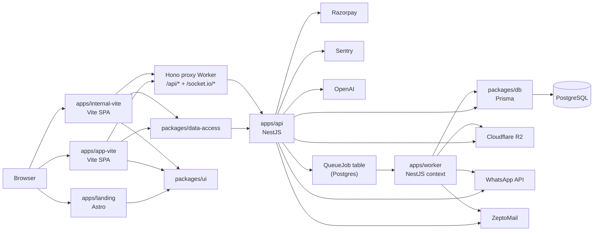

# Architecture

> **Descriptive.** Snapshots what the codebase does today. For prescriptive
> rules new code must follow, see [`AGENTS.md`](../../AGENTS.md). When this
> doc disagrees with the code, the code wins — update the doc.

Docita is a Turborepo monorepo for a healthcare SaaS product handling PHI
(Protected Health Information). Deployed on Fly.io (API + worker) and
Cloudflare (Vite SPA apps with static assets + a tiny Hono proxy Worker).

> **Migration in progress:** the Next.js apps (`apps/app`, `apps/internal`) are
> being replaced by `apps/app-vite` / `apps/internal-vite` (Vite + React Router
> v7). Until cutover, the old apps are still the deployment source. See
> [`PORTING_PLAN_APP_VITE.md`](../PORTING_PLAN_APP_VITE.md).

---

## High-Level Diagram



---

## Apps

| App | Framework | Port | Purpose |
|-----|-----------|------|---------|
| `apps/api` | NestJS 11 | 3001 | REST API, WebSockets, scheduled jobs, queue |
| `apps/app-vite` | Vite 6 + React Router 7 | 3000 | Clinic staff portal (patients, appointments, billing) |
| `apps/internal-vite` | Vite 6 + React Router 7 | 3002 | Internal super-admin tooling |
| `apps/landing` | Astro | 3003 | Public marketing site |
| `apps/worker` | NestJS context | — | Queue consumer; shares `apps/api/src/` via tsconfig alias |

---

## Packages

| Package | Contents |
|---------|----------|
| `packages/types` | Zod schemas for all API request/response contracts — the single source of truth shared by frontend and backend |
| `packages/data-access` | Axios API clients, React Query query-key factories, typed hooks — the only layer allowed to call the API from the frontend apps |
| `packages/ui` | Radix UI + Tailwind presentational primitives (no business logic) |
| `packages/hooks` | Shared React hooks (debounce, media queries, etc.) |
| `packages/utils` | Pure utility functions, date helpers, formatters |
| `packages/auth` | NextAuth configuration shared between `app` and `internal` |
| `packages/db` | Prisma 7 schema, generated client, migration scripts |

---

## Request Flow

```
Browser
  → Vite SPA (React client component)
    → packages/data-access (React Query + Axios)
      → apps/api HTTP controller  (JWT auth guard, RBAC, tenant guard)
        → Service / Use-case
          → Repository (packages/db PrismaClient)
            → PostgreSQL
```

- All controllers are thin — orchestration lives in services/use-cases.
- Repositories are the only code that imports `PrismaClient` directly
  (`check:prisma-boundary` enforces this at CI).
- Tenant isolation is enforced via `TenantGuard` + Prisma RLS middleware.

---

## Background Job Flow

```
HTTP Controller
  → JobQueue.enqueue(jobName, payload)
    → [dev]  in-process memory queue (QUEUE_BACKEND=memory)
    → [prod] INSERT INTO QueueJob (QUEUE_BACKEND=postgres)
               → apps/worker polls QueueJob table
                 → executes handler (email, WhatsApp, PDF generation, etc.)
```

Scheduled jobs (cron) run inside the API via `@nestjs/schedule`.
In production the API sets `ENABLE_SCHEDULERS=false` and the worker sets it
`true` so only one process runs each schedule.

---

## External Services

| Service | Used for |
|---------|----------|
| PostgreSQL (AWS RDS in prod) | Primary datastore + durable `QueueJob` table |
| Cloudflare R2 | Document storage (prescriptions, lab reports, uploads) |
| Razorpay | Payment links, subscriptions, webhook verification |
| WhatsApp Business API (Meta) | Appointment reminders, OTP, broadcast messages |
| ZeptoMail | Transactional email (welcome, OTP, invoice) |
| Sentry | Error tracking + performance tracing (API + Vite SPAs) |
| OpenAI GPT-4 | AI-assisted features (chief complaint parsing, etc.) |
| Cloudflare Turnstile | Bot protection on the public booking form |

---

## Key Boundaries

- `packages/types` — Zod + TypeScript only; no runtime deps.
- `packages/data-access` — API clients only; no direct DB access.
- `packages/ui` — presentational primitives only; no business logic.
- API controllers — no Prisma imports; delegate to repositories (`check:prisma-boundary` enforced in CI).
- Frontend route files — thin shells; logic lives in feature hooks/components.

See `AGENTS.md` §15 for the full Pattern Catalogue.
