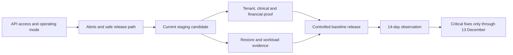

# Docita Two-Month Stability Implementation Plan

**14–15 October follow-up:** full local lint, types, unit suite (6,377 tests),
standards and workspace build pass. Public capability resolution now has real
non-owner/RLS HTTP proof. The full production monitor script passes locally;
GitHub cannot start hosted jobs because of billing/spending restrictions. Final
images build with production dependencies only and pass nine artifact cases,
configured-resource startup/shutdown and raw OS/library scans with zero
HIGH/CRITICAL findings. Neon past-point recovery, an encrypted
synthetic canary, R2 object/key checks and 19 strict isolated RLS cases pass.
All ten pending migrations also pass on a fresh isolated Neon copy, followed by
integrity and 19 strict non-owner checks; that target was removed. Production
still has those 10 pending migrations and owner-role RLS bypass. The user
selected keeping Neon Free and preparing [independent encrypted backups](2026-10-15-independent-database-backups.md).
Production source remains unreleased. Current evidence and credential containment are recorded in the
[repair record](../../audits/2026-10-13-stability-repair-evidence.md).

> **For agentic workers:** REQUIRED SUB-SKILL: Use superpowers:subagent-driven-development (recommended) or superpowers:executing-plans to implement this plan task-by-task. Steps use checkbox (`- [ ]`) syntax for tracking.

**Goal:** Freeze Docita features from 13 October through 13 December 2026, while allowing only critical bug, security and compliance fixes, and establish a demonstrably usable and recoverable production baseline.

**Architecture:** Keep the existing NestJS API/worker, Vite SPAs, Astro landing, PostgreSQL queues/outbox, shared Zod contracts and Fly/Cloudflare deployment model. Repair demonstrated failure boundaries and complete operating evidence; do not start a replacement architecture or a broad cleanup programme.

**Tech Stack:** Node.js 22.22.0 verification baseline, pnpm 10.30.3, Turborepo, NestJS, React Router/Vite, Astro, Prisma/PostgreSQL, Jest, Vitest and Playwright.

**Status:** Execution in progress under the user’s instruction to analyze further and start fixing all. Feature freeze runs through 13 December 2026, with critical bug, security and compliance fixes allowed. Source repairs and operator recovery are being verified; production stability is not yet certified. See [current repair evidence](../../audits/2026-10-13-stability-repair-evidence.md).

## Global Constraints

- Production healthcare system handling PHI; preserve tenant, role, audit and encryption boundaries.
- Node.js `>=22.22.0`; package manager **pnpm only** (`pnpm@10.30.3`). Match the pinned CI/runtime when gathering release evidence.
- Schemas in `packages/types` are canonical. Preserve existing clients through API, schema and frontend release overlap.
- Existing clinic-associated users retain `onboardingStep = COMPLETED`; new requirements use targeted prompts, never a reset to onboarding.
- Frontend fixes use `@workspace/ui`, React Query, React Hook Form/Zod and the current UI standard. Preserve URLs, navigation and authored clinical content.
- Start code changes from current `main`, use focused PRs into `main`, and maintain no more than two open feature/hotfix branches. Staging changes only through PR.
- No PHI, secrets, patient identifiers or provider payloads in public evidence, CI artifacts or diagnostic logs.
- No destructive schema cleanup, historical queue replay, bulk patient repair or live provider sends as a side effect of verification.
- Ordinary feature, layout, pricing, entitlement and dependency-major changes wait until after the freeze. A correctness fix involving those areas must demonstrate critical impact and existing-user compatibility.
- All estimates below assume available operators, working credentials and timely policy decisions. A missed date never substitutes for an acceptance gate.

## 1. Assessment: freeze policy is feasible; production stability is not yet established

The strongest part of Docita is its existing verification and boundary infrastructure. The largest remaining exposure is operational: the publicly reachable API is failing, background processing cannot be verified, monitoring is disabled, staging is old, and recovery has not been rehearsed. More features would increase the amount of behaviour that has to be operated before these gaps close.

### Evidence captured on 13 October 2026

**Initial analysis snapshot (13 October, before operational recovery):**

Canonical source after `git fetch origin`: `376462fe812c9a858e9cf08d1976b2d44275ab7f`, PR [#319](https://github.com/CVamsi27/docita/pull/319), merged 12 October. Analysis used a clean managed worktree at that commit. The original `fix/landing-editorial-redesign` checkout and its uncommitted changes were preserved. No production settings or data were changed.

At final review the original landing branch had independently committed its work
as `4e3032c2d` and was clean. That commit is outside the assessed main baseline;
this analysis did not commit, release or remove it. A final bounded API liveness
check at **14:36 IST** still returned 525.

| Finding                                   | Current evidence                                                                                                                                                                                                                            | Implication / priority                                                                                                                                                        |
| ----------------------------------------- | ------------------------------------------------------------------------------------------------------------------------------------------------------------------------------------------------------------------------------------------- | ----------------------------------------------------------------------------------------------------------------------------------------------------------------------------- |
| Public API failure                        | GET `/api/health/live` and `/api/health/ready` on `api.docita.work` returned **525**. The corresponding app/internal same-origin `/api/health/live` paths also returned **525**.                                                            | **P0:** investigate availability before further release work. This is a point-in-time result, not an uptime measurement.                                                      |
| Frontend HTML is available                | App `/login`, internal `/`, and landing `/` returned 200. No authenticated production journey was exercised.                                                                                                                                | Static delivery works; this does not establish login, patient access or clinical writes.                                                                                      |
| Worker drain authorization fails          | [13 October queue-drain run](https://github.com/CVamsi27/docita/actions/runs/38365602416): `failed to list VMs: unauthorized`.                                                                                                              | **P0:** the configured daily job cannot start the worker. This alone does not prove a separately running worker is stopped.                                                   |
| Monitoring disabled                       | Live GitHub workflow state for `synthetic-monitoring.yml` is `disabled_manually`. The scaling and DB-stop workflows are also disabled.                                                                                                      | **P0:** no current scheduled synthetic coverage through that workflow. Do not enable the DB-stop workflow for an active clinical system.                                      |
| Release route paused                      | `deploy.yml` ignores every push branch; no active dispatch trigger. `db-migrations.yml` is also paused and disabled in GitHub. The Fly CLI has no local access token.                                                                       | **P0:** current deployment identity and a usable emergency-release path are unverified. Historical credential failures are not proof of today's credential state.             |
| Staging differs from main                 | `origin/staging` is `f27ee59936a2bfcc27894fcc7371b4c8b91af3eb`, dated 14 August. Main/staging have 141/2 unique commits; their trees differ across **1,160 files**.                                                                         | **P0:** old staging results cannot validate the current release candidate.                                                                                                    |
| Standards pass on clean main              | Fresh `pnpm verify:standard`, Node **22.22.0**, pnpm **10.30.3**, exit 0; **77 standards tests passed**, none skipped in that test suite.                                                                                                   | Good source baseline. This command is not a full unit/E2E/build run or a production certification.                                                                            |
| Required performance evidence absent      | Fresh `check-api-latency-budget.mjs --require-baseline` exits 1 because `artifacts/api-latency-baseline.json` is absent. The ordinary standards mode explicitly skips it.                                                                   | **P0 release gate:** capture real staging evidence; never hand-author passing numbers.                                                                                        |
| Baselines are historical                  | Web Vitals baseline: **6 August**; bundle/performance baseline: **19 August**. A11y baseline has no top-level capture timestamp.                                                                                                            | Recollect against the release candidate, with viewport, authentication and source provenance. A baseline comparison pass is not fresh measurement.                            |
| Recovery is unproved                      | `DR_RUNBOOK.md`: last drill never; no tracked `dr-drills/` directory. RB-06 is explicitly not executable because `export:tenant` is absent.                                                                                                 | **P0:** a database backup is insufficient without restore, object and decryption evidence. RTO/RPO remain targets.                                                            |
| Dependency exception needs review         | Fresh `pnpm audit --audit-level=high --json` exits 0 with no actionable advisories after configured filtering, while metadata counts **one high** vulnerability. `braces` GHSA-vfj7-8cjw-p6xm is explicitly excepted until **12 November**. | Audit pass is conditional on an exception, not zero vulnerability exposure. Review expiry before it falls inside the freeze. The older three-advisory snapshot is superseded. |
| Container workflow fails in reporting     | [12 October container scan](https://github.com/CVamsi27/docita/actions/runs/38264352286): both Trivy steps passed; both SARIF upload steps failed with `Resource not accessible by integration`.                                            | Repair reporting permissions/capability; do not classify the upload error as a new vulnerability or suppress scanner failures.                                                |
| Payment event consumer remains incomplete | Current worker graph omits the API's payment messaging subscriber. [12 October backend QA](../../audits/2026-10-12-backend-reliability-qa.md) records preserved retry/DLQ intent and the provider boundary.                                 | Required notifications must have a proven consumer and effect-level deduplication, or an explicit recoverable operating procedure. No blind replay.                           |
| Financial semantics remain open           | `getCollectionsByMode` still adds all settled session amounts and returns the last currency encountered. ADR 0015 remains proposed.                                                                                                         | Critical when unlike currencies occur. Confirm exposure and reproduce before patching; settle refund/finalization policy without inventing accounting rules.                  |

Cloudflare defines [525](https://developers.cloudflare.com/support/troubleshooting/http-status-codes/cloudflare-5xx-errors/error-525/) as a failed TLS handshake between its edge and the origin. It identifies the failing boundary, not the exact cause. Operator inspection subsequently confirmed that the current Fly app had no certificate for `api.docita.work`, while the domain ownership and ACME DNS records still identified an older app. The user corrected both DNS records; Fly issued active RSA/ECDSA certificates expiring 11 January 2027. Repeated direct/public/proxied liveness/readiness checks returned 200 at 19:06–19:10 IST. This restores the TLS boundary; authenticated journeys, continuous operating mode and sustained observation still require evidence.

PR #319's recorded checks include successful repository standards, app/internal/landing/worker/API checks, critical frontend E2E and four API E2E shards. Its Security Audit and migration-validation jobs were skipped. These are reviewed CI results; the whole unit suite, full E2E suite, Linux images and deployed revisions were **not rerun or verified** in this analysis.

### Preserve completed repairs

The 12 October backend repair is already on main. Source confirms awaited outbox dispatch, per-event tenant/RLS scope and retry handling. Do not reopen the stale backlog statement that dispatch is synchronous. Retain its RLS transaction, notification lookup/timezone, diagnostic privacy, worker scheduler-registration and Docker package-resolution regressions. Remaining work is production behaviour, consumers, irreversible-effect deduplication and operating evidence.

## 2. Choice of approach

| Approach                                                                                  | Benefit                                                          | Trade-off                                                                                | Decision                                             |
| ----------------------------------------------------------------------------------------- | ---------------------------------------------------------------- | ---------------------------------------------------------------------------------------- | ---------------------------------------------------- |
| **Freeze features immediately; repair critical gaps in small slices; certify a baseline** | Restricts change and addresses failures in the existing product. | Requires operator access and a short initial repair window.                              | **Recommended; matches the user's selected policy.** |
| Complete every roadmap phase before freezing                                              | Could deliver more planned capabilities.                         | Extends churn across clinical, billing, UX and partner surfaces; increases release risk. | Defer discretionary phases.                          |
| Stop every release immediately, regardless of defects                                     | Minimizes intentional source change.                             | Leaves the observed API failure and recovery gaps unresolved.                            | Does not meet the stability goal.                    |

The feature freeze starts now and ends 13 December. The **stable baseline** is declared only after the gates below pass. Fixing a critical incident is allowed during the freeze; the objective is fewer incidents and predictable operation, not a promise that providers or security advisories cannot change.

## 3. Admission policy for changes during the freeze

A change qualifies only when it addresses at least one of: unavailable clinician/patient operations; lost or incorrect clinical data; unauthorized access/PHI exposure; incorrect charging, collection or entitlements; required background work being lost; an applicable high-impact security issue; or a confirmed compliance obligation.

Every admitted change carries a failing reproduction or incident evidence, affected accounts/routes, a named reviewer/release operator, the smallest correction, regression evidence, existing-user impact, rollback and post-release observation. A known vulnerability exception must retain its owner, control and expiry. No automatic merging, routine dependency upgrades or cosmetic redesign releases during the freeze.

Preserve the current landing redesign as pending work; do not discard it. Its visual/product changes are deferred by default. If a specific contact, pricing or navigation defect blocks an existing customer flow, extract that minimal critical fix into its own reviewable slice. Apply the same rule to AI expansion, referrals, ABDM/insurance expansion, pricing changes and broad architecture cleanup.

Release/platform owns the freeze register and deployment identity; backend owns API/worker/data correctness; frontend owns authenticated/browser compatibility; clinical, billing and security/compliance owners decide the policies in their domain. Name actual people and an alert destination in the release record before work enters production. Ownership roles in this plan are not a claim that an on-call rota already exists.

## 4. Critical path and proposed dates

| Window (IST dates)                               | Work                                                                                                                                                                                               | Exit condition                                                                                                                                                      |
| ------------------------------------------------ | -------------------------------------------------------------------------------------------------------------------------------------------------------------------------------------------------- | ------------------------------------------------------------------------------------------------------------------------------------------------------------------- |
| **13–14 October**                                | T1 availability investigation; T2 operating mode and worker access; T3 external alerting and emergency release path.                                                                               | Direct/public/proxied API health and one authorized journey work; outages page a real operator; required jobs have a functioning runner.                            |
| **15–23 October**                                | T4 staging alignment; T5 tenant/legacy-account proof; T6 provider/worker proof; T7 critical clinical/financial tests; T8 recovery drill; T9 measured performance/security; T10 controlled release. | All release blockers closed with candidate-specific evidence; no skipped required gates.                                                                            |
| **After candidate release: 14 consecutive days** | T11 observe clinical journeys, payment reconciliation, queue age, heartbeat cadence and resource trends through ordinary peak traffic.                                                             | No unresolved critical regression, no unexplained backlog growth or leak, and alert/restore evidence is usable. An incident resets the relevant observation period. |
| **Remainder through 13 December**                | T12 operate the freeze; critical fixes only. Review the security exception **before 12 November**.                                                                                                 | Daily operating checks and weekly owner review; each exception has evidence and a release record.                                                                   |

The repair window is an estimate, not a commitment to ship by 23 October. Access, recovery or policy blockers can extend it. Do not call the product stable while a required gate remains blocked.



## 5. Execution tasks

Each task ends in independently reviewable evidence. For a reproduced code defect, first approve the narrow design, then use regression-first implementation in the closest existing module. This programme does not preselect speculative patches for causes that have not been established.

### T1 — Diagnose and recover API availability (P0; release/platform)

**Files/reference:** `fly.toml`; `apps/app/api/index.ts`; `apps/internal/api/index.ts`; `docs/operations/playbooks/cloudflare-upstream-timeout.md`; `docs/operations/RUNBOOKS.md` RB-13/RB-14.

**Consumes:** current production account access, DNS/origin configuration and deployed revision metadata. **Produces:** cause-specific incident evidence and a healthy public API; deployed image/config identity.

- [x] Repeated bounded direct/public/proxied liveness/readiness probes recovered to HTTP 200 after TLS repair; timings and certificate identity are retained in the repair evidence.
- [x] Read Fly machine/release/certificate metadata and authoritative DNS; `.fly.dev` worked while the custom domain had no certificate and old-app challenge/ownership records.
- [ ] Confirm actual database/storage connectivity through readiness; do not replace readiness with a liveness-only check.
- [x] Requested the current app certificate and verified the user’s DNS correction. Active certificates and repeated health checks confirm TLS recovery; HTTPS validation was preserved.
- [ ] Verify `/api/health/live`, `/api/health/ready`, same-origin proxy paths and an owned synthetic authorized login/patient-list journey. Record production revision and one hour of post-recovery health.

**Acceptance:** all required paths return expected results, with authenticated backend operations succeeding. Frontend HTML alone and an origin-only 200 do not pass.

### T2 — Fix the runtime operating model (P0; backend/platform)

**Files/reference:** `fly.toml`; `apps/worker/fly.toml`; `.github/workflows/daily-worker.yml`; `.github/workflows/scale-api-hours.yml`; `scripts/deploy/run-daily-worker.sh`; `apps/api/src/worker.module.ts`; `apps/api/src/shared/modules/schedule/cron-heartbeat.ts`.

**Consumes:** T1 infrastructure identity, valid least-privilege Fly access and measured job/care windows. **Produces:** one documented runtime owner for every scheduler/queue and a verified service schedule.

- [x] Verify token permissions by metadata and permitted read operations; API and worker app-scoped credentials were rotated securely for 90 days and GitHub secret metadata confirms the updates.
- [ ] Inventory the actual API and worker machines, regions, memory limits, scheduler flags, queue/outbox age and last successful runs. Configuration does not prove a machine is running.
- [x] Resolve API operating mode: the user chose **keep idle shutdown enabled**. Retain that choice and record the observed approximately 28-second cold start; do not claim continuously warm service. Worker cadence/operating mode remains to be demonstrated.
- [ ] If the worker runs continuously, remove or guard the daily script's unconditional stop behaviour. If a bounded worker window is retained, prove that every required cadence/deadline is met; a five-minute once-daily drain cannot be assumed sufficient.
- [ ] Keep scheduled execution in the worker (`ENABLE_SCHEDULERS=true`) and out of the API (`false`) unless a separately tested ownership change is required.
- [ ] Test scheduler readiness, crash/restart, graceful shutdown, duplicate runners, queue drain and work arriving during shutdown using disposable data/providers. Confirm measured lag stays within the published worker target.

**Acceptance:** required jobs run at their actual cadence, interrupted work resumes, and no workflow stops the continuous worker. Do not blindly re-enable the legacy scale-to-zero or DB-stop jobs.

### T3 — Establish alerts and a usable hotfix route (P0; release/platform)

**Files/reference:** `.github/workflows/synthetic-monitoring.yml`; `scripts/monitoring/synthetic/run-probes.mjs`; `scripts/monitoring/synthetic/fly-recovery.mjs`; `.github/workflows/deploy.yml`; `.github/workflows/db-migrations.yml`; `docs/operations/SYNTHETIC_MONITORING.md`; `docs/operations/RELEASE_EVIDENCE_CHECKLIST.md`.

**Consumes:** T1/T2 operating model and a named operator/alert destination. **Produces:** tested alert delivery and an exact, controlled release procedure.

- [ ] Review current trigger and GitHub enable/disable states separately. Select a controlled release entry point from `main` with existing path-scoped targets and all mandatory gates retained.
- [ ] Verify Cloudflare account scope, Fly deploy scope, Turnstile API/runtime/build settings and migration access without exposing values. Record which targets are genuinely deployable.
- [ ] Restore synthetic coverage once its runtime prerequisites are met. Missing authentication fixtures or an unavailable API remain explicit missing evidence.
- [ ] Configure independent minute-level availability checks through the approved monitoring service and test outage, alert delivery, acknowledgement and recovery. GitHub's three daily probes and its seven-day staleness guard cannot alone substantiate a 99.9% uptime target or timely paging.
- [ ] Alert on oldest queue/outbox age, retries/DLQ, database pool wait, worker/scheduler liveness, audit-write failures and release-tagged errors. Derive per-job staleness from actual cron cadence; do not use one guessed threshold for all jobs (T-F1-F6).
- [ ] Test emergency release and rollback in staging. Retain bounded auto-recovery behaviour; avoid repeated machine restarts as a substitute for diagnosis.

**Acceptance:** an induced failure reaches the named operator; the correct release artifact can be deployed/rolled back without undocumented local knowledge. An exit-0 credential skip is a blocked target, not a release success.

### T4 — Align staging with the current candidate (P0; release/platform)

**Files/reference:** `docs/operations/STAGING.md`; `docs/operations/BRANCH_CONSOLIDATION_PLAYBOOK.md`; `.github/workflows/deploy.yml`; `scripts/workflow/detect-workflow-scope.mjs`.

**Consumes:** selected immutable main candidate and T3 release procedure. **Produces:** current staging revision/schema/provider-fixture identity.

- [ ] Record main and staging SHAs and tree differences immediately before the mirror.
- [ ] Follow AGENTS.md's PR-only staging re-mirror pattern: branch from staging and replace its tree with the selected main tree in one reviewed commit. Do not push directly or assume divergent squash histories merge cleanly from a main-based branch.
- [ ] Verify deployed staging source/tree, safe migration status, app-role privileges and environment parity. Retain synthetic fixtures and test provider destinations.
- [ ] Ensure old production frontend bundles remain compatible with the candidate API and that a previous API image works against any additive migration.

**Acceptance:** staging tests exercise the selected candidate, not August code. Render deployment completion, schema compatibility and source identity are attached to the evidence record.

### T5 — Prove tenant boundaries and existing-account continuity (P0; security/backend)

**Files/reference:** `packages/db/scripts/check-tenant-isolation.mjs`; `docs/compliance/RLS_ROLLOUT.md`; `apps/api/test/e2e/queue/outbox-delivery.e2e-spec.ts`; API resource-policy E2E; `apps/app/e2e/smart-auth.spec.ts`; `docs/operations/REQUIRED_SETTING_ROLLOUT_CHECKLIST.md`.

**Consumes:** T4 staging clone/fixtures with production-equivalent application-role privileges. **Produces:** denied-case evidence, role/policy verification and existing-account acceptance.

- [ ] Run the tenant matrix with strict preconditions on an **owned disposable database**. The harness creates scratch schemas/roles; do not point it blindly at production or describe it as read-only.
- [ ] Verify actual deployed application roles are non-owner/non-BYPASSRLS through safe operator reads, and test the real application resource paths under those privileges in the disposable environment. The harness's scratch policy table is not complete application-table certification.
- [ ] Cover two clinics, simultaneous requests, primary-key/relational/raw-SQL access, transactions, pool reuse, INTERNAL operations, worker/outbox delivery and nullable-tenant records.
- [ ] Cover pre-change clinic-associated accounts with stale/missing consent/settings state, refresh/CSRF/logout/revocation, doctor/front-desk roles and tier/mode restrictions. Retain their workspace access and existing data.
- [ ] Verify representative clinical reads and writes are audited; inspect scrubbed errors/logs using synthetic markers only.

**Acceptance:** no unauthorized operation succeeds; stale clinic-associated accounts land in the workspace; intentional privileged operations are attributable; missing role prerequisites fail the release gate.

### T6 — Prove required asynchronous/provider effects and record best-effort notifications (backend)

**Files/reference:** `apps/api/src/shared/modules/queue/`; `apps/api/src/shared/modules/outbox/`; `apps/api/src/worker.module.ts`; `apps/api/src/domains/whatsapp/whatsapp-clinic.module.ts`; `apps/api/src/domains/billing/application/services/payment-capture-reconciliation.service.ts`; `apps/api/test/e2e/queue/`; `apps/api/test/e2e/webhooks/razorpay-payment-webhook.e2e-spec.ts`.

**Consumes:** T2 functioning runners and T4 synthetic provider environment. **Produces:** event-to-consumer ownership matrix, required-effect retry evidence and reconciliation procedure.

**Decision recorded 13 October:** payment WhatsApp receipts and staff notifications retain best-effort behavior for the freeze. Capture success and outbox acknowledgment do not promise notification delivery. See [worker event ownership](../../operations/WORKER_EVENT_OWNERSHIP.md); no durable sending policy or historical replay is introduced.

- [ ] Inventory emitted event names against consumers in the **compiled worker graph**, including payment notifications. Classify required effects and deliberate no-subscriber events explicitly.
- [ ] Reproduce no subscriber, listener rejection, duplicate delivery, lease expiry, competing workers and crashes immediately before/after an external effect and acknowledgement.
- [ ] If a required consumer is missing, implement only that proven gap with stable provider/business idempotency identity. Keep unsent historical events quarantined until ownership and duplicate handling are verified.
- [ ] Exercise payment duplicate/reordered/wrong-clinic/amount-mismatch callbacks and provider-success/local-failure recovery in the provider sandbox; reconcile provider and local state.
- [ ] Verify messaging recipient consent, rate limits, accepted/delivered distinction and clinical-flow usability when WhatsApp/AI/storage providers fail.
- [ ] Document DLQ diagnosis and targeted redelivery, including who may approve historical financial/notification replay.

**Acceptance:** no lost required effect or duplicate financial effect under the tested failures; provider acceptance is never mislabeled delivery. Existing mock-only tests do not close F01/provider evidence.

### T7 — Close critical clinical/financial defects without extending product scope (backend/frontend/product)

**Files/reference:** `apps/api/src/domains/billing/application/services/invoices-query.service.ts` and adjacent spec; `packages/types/src/billing/`; `docs/architecture/decisions/0015-billing-accounting-semantics.md`; appointment/IPD domain tests; `apps/app/e2e/{today,appointments,queue,prescriptions,invoices,lab-tests,subscription}.spec.ts`.

**Consumes:** T5 role/account matrix, T6 financial-effect evidence and domain-owner decisions. **Produces:** minimal critical corrections and one complete clinician lifecycle report.

- [ ] Reproduce mixed-currency collections with two schema-valid payment sessions; assess actual supported-currency exposure. Resolve ADR 0015's currency/refund/finalization choices with billing ownership before changing the wire shape.
- [ ] Verify integer-money identities, discount/tax rounding, capture/refund/late settlement, historical finalized context and tier/mode changes. Preserve old-client compatibility; new reporting features wait.
- [ ] Exercise find patient → book/reschedule → Today/queue → start/resume consultation → prescribe/lab order → complete → invoice/collect → retrieve document/audit. Include retries, lost response, concurrent clicks and provider/API failure.
- [ ] Assert saved clinical drafts survive a failed submission; stale appointment actions cannot silently corrupt terminal visits; duplicate completion/collection creates one effect. Resolve the existing W01-F1/F2 policy question with its owner rather than imposing a new clinical rule.
- [ ] For clinics using IPD, verify patient/bed admission ownership, transfer/discharge races and any direct-write path. Add a database invariant only after a scoped duplicate audit/reconciliation and safe additive migration prove necessity (W02-F1).
- [ ] Verify prescription/result/document patient identity, clinician authorization and reviewed clinical fixtures. Obtain clinical sign-off where correctness cannot be established by schema validity.
- [ ] Run authenticated mobile/desktop, keyboard, loading/error/empty/stale cases; no visual redesign is admitted through this task.

**Acceptance:** required journeys pass using real API/database fixtures, financial effects occur once, and critical clinical cases have owner sign-off. Scope to the product actually offered; unverified optional integrations retain their honest status.

### T8 — Rehearse data, object and key recovery (P0; security/operations)

**Files/reference:** `docs/operations/DR_RUNBOOK.md`; `docs/operations/RUNBOOKS.md` RB-06; `docs/operations/KEY_ROTATION.md`; `docs/architecture/decisions/0016-patient-data-lifecycle-and-recovery.md`; `docs/compliance/DPDP_READINESS.md`; create a dated record under `docs/operations/dr-drills/`.

**Consumes:** approved retention/recovery policy, actual backup access and isolated restore destination. **Produces:** measured restore/decrypt/access evidence and executable operator instructions.

- [ ] Identify the actual production database/provider, backup schedule, retention, object version/recovery options and key custody from operator metadata. Do not assume the historical RDS description still identifies the live database.
- [ ] Resolve ADR 0016's recovery, retention/legal-hold and restored-erasure semantics with security/compliance ownership; use the existing approved policy until a change is explicitly signed off.
- [ ] Restore a backup into an isolated destination. Verify critical record relationships, invoice/clinical integrity, referenced objects and audit continuity without exporting PHI to public artifacts.
- [ ] Rehearse historical-key recovery/rotation and decrypt pre-rotation fixtures; verify cross-tenant reads fail after restore.
- [ ] Prove a tenant-specific recovery procedure or keep RB-06 clearly unsupported with the exercised alternative. Do not invent an `export:tenant` command merely to satisfy the runbook.
- [ ] Measure elapsed recovery and maximum lost interval, record cleanup and a named operator, and compare against explicitly approved RTO/RPO targets. Review deletion/erasure replay before reopening a restored system.

**Acceptance:** a fresh operator can follow the written procedure and recover readable, correctly scoped data and objects. Untested RTO/RPO and "backup configured" do not pass.

### T9 — Gather current workload and security evidence (release/backend/frontend)

**Files/reference:** `scripts/perf/capture-api-latency-soak.mjs`; `scripts/perf/api-latency-soak-routes.mjs`; `scripts/checks/api-latency-slos.mjs`; `docs/operations/SLOS.md`; `artifacts/`; `.github/workflows/container-scan.yml`; `docs/compliance/SECURITY_ALLOWLIST.md`; `osv-scanner.toml`.

**Consumes:** T4 candidate, working synthetic credentials, T6/T7 accepted workloads and owned capacity-test environment. **Produces:** candidate-specific measurements, scan disposition and reviewed exception register.

- [ ] Capture/convert the existing paced staging soak with source/environment/cache/error/sample provenance. This is latency evidence, not a capacity benchmark. Then run required-baseline enforcement with a seven-day freshness limit for this baseline release.
- [ ] Measure mixed clinical traffic, pool wait, peak tenant/list sizes, PDF jobs, deployment overlap and cold/warm behaviour in staging. Size API/worker/pools from memory, CPU, queue age and failure observations; do not simply enlarge the DB pool.
- [ ] Capture current Web Vitals, bundle and authenticated accessibility evidence at 360/768/1440 CSS pixels; retain raw reports privately and link provenance. Do not rebaseline away violations.
- [ ] Run full current dependency/OSV scans, including base-tree findings. Retain the existing `braces` exception only while its control is demonstrated; review by 5 November and resolve or explicitly reapprove before **12 November**. The repair adds expiry enforcement against the canonical `osv-scanner.toml` dates in `verify:standard`; this does not automatically resolve or extend the exception.
- [ ] Repair container scan reporting using the existing CI SARIF capability/opt-in pattern; preserve scanner failure semantics. Inspect built Linux API/worker images and native module startup separately from filesystem scanning.
- [ ] Freeze reviewed lockfile, runtime and actual deployed image/frontend artifact identities. No dependency-major or provider replacement is necessary for this programme.

**Acceptance:** complete fresh measured evidence meets the canonical budgets; build/image checks work; every advisory is remediated or has an applicable, owned, time-limited disposition. Historical baseline comparisons and filtered audit exit codes are described accurately.

### T10 — Release and certify one baseline (P0; release owner)

**Files/reference:** `docs/operations/RELEASE_EVIDENCE_CHECKLIST.md`; create the actual release's dated record under `docs/operations/releases/`; `docs/operations/DEPLOYMENT.md`; `docs/operations/REQUIRED_SETTING_ROLLOUT_CHECKLIST.md`.

**Consumes:** T1–T9 accepted evidence and immutable candidate. **Produces:** deployed baseline inventory, rollback proof and named post-release health ownership.

- [ ] Run the complete release command set below on the final candidate, with protected fixtures and required evidence. Rerun affected checks after a correction; do not mix results from different trees.
- [ ] Record exact API/worker images, app/internal/landing deployment IDs, migration state, schema/client compatibility, names of changed environment variables and alert owner. Actual secret rollback values stay in approved secret custody, not the Markdown checklist.
- [ ] Rehearse the previous image/frontend artifact against the current additive schema in staging. Resolve the stability runbook's historical `down.sql` guidance against the deployment guide's code-rollback policy; never automatically undo production migrations.
- [ ] Deploy only affected targets through the controlled main release route. Validate authorized operations, denied roles, audit records, queues and representative customer paths for the first hour.
- [ ] Retain and deliberately close the rollback window with operator sign-off. Start T11 only after all required targets have actually deployed and are healthy.

**Acceptance:** a complete release record identifies what is live, how to revert safely and who responds. Main being merged, a green skipped target or a source build alone does not pass.

### T11 — Observe the baseline for 14 consecutive days (operations)

**Consumes:** T10 live baseline and T3 working independent alerts. **Produces:** stability observation report, unresolved-incident list and freeze-baseline decision.

- [ ] Observe real peak traffic and synthetic journeys; record uptime from external coverage, not retained telemetry bounds.
- [ ] Reconcile payment outcomes and oldest queue/outbox age daily; verify scheduler cadence, audit continuity and resource trends across restarts.
- [ ] Investigate every new critical error, growth trend, repeated manual intervention or unexplained retry. Normal authorized denials and intentionally empty data are distinct from failures.
- [ ] Repeat the relevant observation window after a critical repair; record the new artifact identity and its effect on the baseline.
- [ ] Declare the baseline stable only with no unresolved P0/P1 affecting offered critical journeys, measured recovery, working alerts and sufficient observation coverage. Retain any non-critical debt explicitly.

**Acceptance:** 14 days of observable healthy operation with no unexplained data/financial discrepancy, sustained backlog, resource leak or recurring critical incident. This establishes bounded evidence, not a guarantee of zero future defects.

### T12 — Operate the feature freeze through 13 December (release owner)

- [ ] Review health, failed/overdue jobs, provider reconciliation and backup completion daily through the approved operating tools.
- [ ] Review incidents, error-budget use, exception expiry, certificate/token renewal dates and capacity weekly. Rehearse alert receipt after changes to ownership/routing.
- [ ] Admit only qualifying critical changes using section 3; release small fixes with relevant checks, rollback and post-release monitoring. Keep remote branches within the cap and delete merged/closed feature branches.
- [ ] Reassess the `braces` exception before 12 November and retain the full scan evidence. Do not silently extend an ignore through the remainder of the freeze.
- [ ] On 13 December, review incident history, actual availability, restore capability and remaining debt before selecting the next product work. Completing the calendar alone does not reopen features automatically.

## 6. Required verification and evidence

Run from the final candidate with the pinned Node/pnpm runtime. The commands below are the release requirements, **not a claim they all ran during this analysis**.

```bash
pnpm install --frozen-lockfile
pnpm lint
pnpm verify:standard
pnpm check:hygiene
pnpm knip
pnpm turbo check-types --continue
pnpm test
pnpm build
pnpm check:prisma-boundary
pnpm check:utc-instant-storage
pnpm check:circular:enforce
pnpm audit --audit-level=high
pnpm check:api-latency-budget --require-baseline --max-age-days 7
```

Run API E2E in sequential fresh shards if local memory cannot support the unsharded process; preserve complete coverage and report every shard. Use owned disposable DBs, never production-reset fixtures.

```bash
pnpm --filter @docita/api run test:e2e:shard 1/4
pnpm --filter @docita/api run test:e2e:shard 2/4
pnpm --filter @docita/api run test:e2e:shard 3/4
pnpm --filter @docita/api run test:e2e:shard 4/4
pnpm --filter @docita/worker run lint
pnpm --filter @docita/worker run check-types
pnpm --filter @docita/worker run test
pnpm --filter @docita/worker run build
```

For affected frontend targets, run their production Cloudflare build and authenticated route/browser/a11y suites. Run `pnpm audit:app`, `pnpm audit:internal` and `pnpm audit:landing` for the baseline; a public-only app audit does not replace protected-route evidence. Run `pnpm check:colors` when shared tokens/themes change. Include Linux image startup/shutdown, native dependencies and provider sandbox proof outside these source commands.

On the disposable role-equivalent database, use `pnpm --filter @workspace/db run db:check-tenant-isolation -- --strict-preconditions`. For a migration, run the safe dry-run/safe migration scripts and applicable integrity/query-plan guardrails in that environment first. Production migration or data repair is a separate controlled release action.

Preserve canonical latency targets from `SLOS.md` / `api-latency-slos.mjs`: auth p95 300 ms; CRUD p95 200 ms/p99 500 ms; search p95 400 ms; reports p95 1,500 ms; webhook ingress p95 100 ms. The developer gate's 25% tolerance is not permission to claim the published target was met. Use the stability runbook's 99.9% API availability and worker targets only with actual independent observation; update its conflicting historical search/capacity statements rather than creating another SLO source.

## 7. Decision gates and completion

| Gate                      | Must exist before declaring stability                                  | Current state                                                                                                              |
| ------------------------- | ---------------------------------------------------------------------- | -------------------------------------------------------------------------------------------------------------------------- |
| Usability                 | Public/proxied health plus authenticated offered journeys              | **TLS recovered; authenticated release journey and observation open**                                                      |
| Release control           | Current staging, deploy identities and tested emergency/rollback route | **Paused; current Neon recovery/RLS rollout and staging proof required**                                                   |
| Isolation/continuity      | Role-equivalent matrix, actual-role metadata, old-account regression   | **Local strict matrix verified; production owner bypass and 16 missing policies confirmed**                                |
| Financial/background work | Replay/crash/provider reconciliation and running consumers             | **Scoped access repaired; source shutdown fixes verified; best-effort notifications selected; provider/worker proof open** |
| Recovery                  | Timed database/object/key restore and tenant checks                    | **Bounded Neon/object/key drill passes; independent encrypted backup activation and full continuity remain open**          |
| Performance/accessibility | Fresh complete candidate measurements and required budgets             | **Required latency artifact absent; authenticated app accessibility 160/160 passes, markup unchanged**                     |
| Security                  | Full scans and valid reviewed exceptions through their expiry          | **Final images raw/filtered HIGH/CRITICAL zero; development-only November exception unchanged; production isolation open** |
| Observation               | 14 consecutive measured healthy days and accountable operator          | **Not started**                                                                                                            |

TLS and operator access are restored and the local source repair batch is verified.
The next release work is hosted CI/alert recovery, complete migration and staging
proof, independent backup activation, native workload measurements and the
production observation window. Follow the [repair record](../../audits/2026-10-13-stability-repair-evidence.md)
for the current gate order; historical findings above describe the initial audit.

## 8. Companion documentation and status ownership

- [Improvement backlog](../../operations/DOCITA_IMPROVEMENT_BACKLOG.md): remains the owner of domain backlog IDs. Update stale A02/deployment/security status from evidence; do not reopen completed repairs or mark provider gaps closed from unit tests.
- [7 October roadmap](../../operations/2026-10-07-improvement-roadmap.md): discretionary UX/product phases are deferred during this freeze; admitted critical fixes follow this plan.
- [Stability runbook](../../operations/STABILITY_RUNBOOK.md): operating procedure; reconcile stale measurement/capacity/rollback claims with actual manifests and the deployed system.
- [Release checklist](../../operations/RELEASE_EVIDENCE_CHECKLIST.md), [deployment guide](../../operations/DEPLOYMENT.md), [SLOs](../../operations/SLOS.md), [DR runbook](../../operations/DR_RUNBOOK.md) and signed domain ADRs: authoritative acceptance/operations details; keep one canonical definition per datum.

Self-review: assessed source and live metadata are separated from historical reports; every observed blocker maps to a task and gate; discretionary work is deferred; estimates remain conditional; no implementation/deployment or completed stability claim is implied by this plan.
