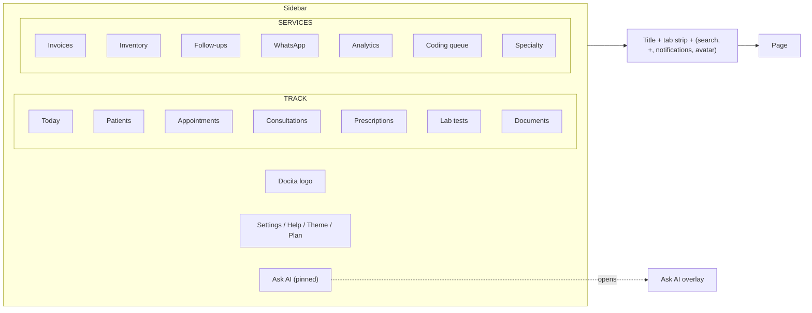

# Docita UI/UX Standard 2026 (Origin-inspired)

This standard supplements (does not replace) [docs/ui/DESIGN_SYSTEM.md](DESIGN_SYSTEM.md), [docs/ui/UI_UX_CONTRACT.md](UI_UX_CONTRACT.md), [docs/ui/UI_UX_ALL_SCREENS_AUDIT_MATRIX.md](UI_UX_ALL_SCREENS_AUDIT_MATRIX.md), [docs/ui/UI_REDESIGN_CHECKLIST.md](UI_REDESIGN_CHECKLIST.md), and [docs/ui/PAGE_STANDARDIZATION_CHECKLIST.md](PAGE_STANDARDIZATION_CHECKLIST.md). Where they conflict, this document wins for the doctor web app.

The visual reference is the Origin web app (April 2026), captured in `artifacts/Origin web Apr 2026/`. Docita borrows Origin's information architecture and surface language while remaining a clinical workspace, not a financial advisor.

## 0. Going forward (authoritative source)

- This document is the authoritative UI/UX source for `apps/app-vite`, `apps/internal-vite`, and `apps/landing` going forward. Where it conflicts with [`docs/ui/DESIGN_SYSTEM.md`](DESIGN_SYSTEM.md) or [`docs/ui/UI_UX_CONTRACT.md`](UI_UX_CONTRACT.md), this file wins; those files remain for historical and detailed reference.
- Every new page or feature MUST start from the primitives in §3, the AI surface contract in §4, the motion/density rules in §5, and the per-page test contract in §7. The per-feature checklist in §9 must be ticked before merge.
- Deviations are allowed only when the PR description includes an explicit dated note explaining the trade-off and, when relevant, a follow-up issue link.
- SOLID, KISS, DRY, comments policy, logging policy, and the broader engineering conventions are governed by [`AGENTS.md`](../AGENTS.md) §7 (Logging/Comments/Hygiene) and §12 (Design Principles). Read those alongside this standard; the rules compose, they do not replace each other.

## 1. Information architecture (mandatory)

### 1.1 Sidebar grouping

The doctor sidebar is a sectioned list. Each section is rendered with an all-caps micro-label and contains ordered nav items. No flat lists.

- **TRACK** is the clinical work surface: `/today`, `/consultation`, `/appointments`, `/patients`, `/desk/collect-payment`, `/invoices`, `/daybook`, `/insurance-claims`, `/prescriptions`, `/lab-tests`, `/documents`.
- **SERVICES** is the operational surface: `/whatsapp`, `/inbox`, `/inventory`, `/vaccines`, `/referrals`, `/follow-ups`, `/analytics`, `/import`, plus dynamic specialty entries (`/specialty/dental-charts`, `/hospital/beds`).
- **Footer** holds Settings (`Link`), Help, theme toggle, and (for billing-capable admins) Plan.
- **Ask AI** is pinned at the very bottom of the sidebar and is always visible; it opens the global AI overlay scoped to the current surface.

`/dashboard` is retired; middleware redirects it to `/today`. `/upgrade` remains a middleware redirect to `/settings?tab=subscription` and never appears in nav.

### 1.2 Topbar

Origin-style minimal topbar:

- **Leading**: page title (or breadcrumbs when nested) and an optional `PageTabs` strip directly under the title.
- **Trailing cluster** (right-to-left): user avatar menu, gear (Settings shortcut), notifications bell with unread dot, `+` quick-add (opens a small sheet for new patient/appointment/invoice/start consultation), command palette opener with `Kbd` hint.
- The trailing cluster must remain visible on mobile via a single `MobileHeader` (`md:hidden`) that includes the command palette opener, global search, quick-add `+`, and Ask AI. `DesktopTopBar` is desktop-only (`hidden md:block`).

### 1.3 Command palette parity

Every nav destination must appear in the command palette, and every palette quick-action URL must match the destination's actual query/state contract. The palette is the canonical navigation surface; sidebar and palette must not drift.

### 1.4 New IA destinations

These are added in PR F:

- `/help` — wired Help center (FAQ + what's new + contact).
- `/inbox` — unified staff-notification hub with links to follow-up tasks, join requests, and coding queue items.
- `/whatsapp` — patient conversation inbox, clinic campaigns, reusable templates, and delivery health. Sender credentials remain admin-only under `/settings/whatsapp-sender`.
- `/templates` — note templates, prescription templates, SMS/WhatsApp templates, consent forms.

## 2. Visual language

### 2.1 Surfaces

- **Soft surround**: page background uses `bg-muted/40` (Origin's tan-gray); cards sit on `bg-card` with `--radius-md`.
- **Card chrome**: every card may carry a `MicroLabel` (all-caps, `var(--fs-2xs)`, `tracking-wide`, `text-muted-foreground`) above the headline. This is the Origin pattern (`NET WORTH`, `SPEND LAST 7D`).
- **Elevation ramp**: use `--surface-1`/`--surface-2`/`--surface-3` tokens; never composite `bg-card` with alpha overlays.

### 2.2 Typography

- Default sans (Inter) for all UI.
- Reserve a serif accent (Tailwind's default serif stack via `font-serif`) for hero/empty-state moments only: onboarding hero ("Welcome, Dr. Sharma"), `/today` morning greeting, weekly recap titles. Never for body copy or controls.
- Keep the hierarchy from `UI_UX_CONTRACT.md` §2: `text-3xl font-bold tracking-tight` for page titles, `text-xs text-muted-foreground` for helper.

### 2.3 Color and intent

- Bind everything to OKLCH tokens in `globals.css`. Raw hex is forbidden outside the token file.
- `--accent` is reserved for AI surfaces (Ask AI button, AI suggestions, AI-authored chips).
- Status pills use `--info` / `--success` / `--warning` / `--destructive` and never raw Tailwind colors.

### 2.4 Iconography

- `lucide-react` only, default stroke 1.5.
- `CategoryAvatar` (tinted circle with icon) for medication classes, lab categories, document types, follow-up reasons. Never freestyle icon-in-circle compositions.

## 3. Component patterns

### 3.1 Modals

- Small (max 480px), centered.
- Header: optional back arrow (multi-step only), all-caps category prefix (`MicroLabel`), close `×`.
- Body: form fields or content.
- Footer: light secondary action left, dark primary action right.
- Use `WizardDialog` for multi-step flows (step pips visible).

### 3.2 Forms

- Floating-label `Input` variant by default.
- Eye toggle for secret fields.
- Inline rules list under password fields (Origin pattern).
- Inline validation under field, never above.
- Primary action on the right; cancel on the left.

### 3.3 Right-rail advisor cards

- `RightRailCardStack` on `/today` and patient detail.
- Each card is dismissible (`×` upper right), carries a `MicroLabel` category, headline, optional CTA (dark primary button).
- Use cases: verification reminders, weekly recap, payments due, expiring inventory, pending join-requests, drug-interaction alerts on patient detail.

### 3.4 Lists and tables

- Use `DataTable` from `@workspace/ui` with `stackOnMobile` for clinical lists.
- Empty/loading/error via `DataState` at the page level (not inline rows).
- Row primary action visible; secondary actions collapse into an overflow `…` menu (no more than one visible primary per row).

### 3.5 Tab strips

- `PageTabs` thin-underline component for in-page section switching (Origin's Overview / Transactions pattern).
- Tabs sync to the URL (`?tab=`). Always preserve back-compat for old tab values when refactoring.

### 3.6 Mobile companion patterns (2026 responsive pass)

Use these `@workspace/ui` primitives for phone/tablet layouts; prefer Tailwind breakpoints first, primitives for repeated row/step chrome:

| Primitive                  | Use when                                                                                          |
| -------------------------- | ------------------------------------------------------------------------------------------------- |
| `SegmentedControl`         | Queue filters, mobile section tabs, role switchers (pill segmented control)                       |
| `StepProgress`             | Consultation SOAP steps, wizard section nav on `< md`                                             |
| `ListRow` + `ListRowGroup` | `DataTable` `stackOnMobile` card fallback; queue/inbox rows (token · name · meta · time · status) |
| `BottomActionBar`          | Primary + secondary actions docked at bottom on `< md` (Next patient, save, quick replies)        |
| `NowServingBoard`          | Today/consultation queue hero (uses `--brand-ink` / `--brand-cyan`; do not duplicate)             |

- `Dialog` / `WizardDialog` become full-height bottom sheets below **`md`** (768px).
- Clinical lists: `DataTable` with `stackOnMobile`, `mobileRenderer` → `ListRow`, `hiddenOnMobile` on low-priority columns.
- No emoji in bottom actions; Lucide icons + sentence-case labels only.

## 4. AI surface contract

- **Permanent affordance**: `AskAiButton` pinned to the sidebar bottom is mandatory.
- **Overlay**: `AskAiOverlay` is full-screen, with a left history rail ("Today" + prior threads), main chat pane, `PromptInput` at the bottom, contextual scope chip ("on Patient X", "on Consultation #123") above the input, and a footer disclaimer ("AI suggestions are not medical advice.").
- **Contextual entries**: every primary surface (Today, patient detail, consultation, appointments) renders an "Ask AI" button in its `PageHeader` action slot or topbar. Clicking opens the same overlay pre-scoped to that surface.
- **Routes**: `/ai-assistant` remains as a deep-link entrance and renders the same overlay shell; the route exists so palette and bookmarks work.

## 5. Motion, density, mobile

- **Motion**: no `animate-pulse` on chrome (only for critical live status); no skeleton `animation="wave"`; no decorative `animate-in fade-in slide-in-from-bottom-*` on auth/onboarding; no `transition-all`. Only `animate-spin` for explicit loading and `transition-colors duration-150` for hover/focus.
- **Density**: defaults to `comfortable`; `compact` must be exercised on consultation, patients list, and appointments calendar (visual-test page).
- **Mobile**: sidebar collapses to a `Sheet`; topbar trailing cluster keeps palette opener and `+`; right-rail cards become a horizontal scroll strip below the page header; modals expand to full-height `Sheet` below `md`.

## 6. Tokens (single source of truth)

- `packages/ui/src/styles/globals.css` is the only authoritative token file.
- `packages/ui/src/design-tokens.ts` is mirrored from CSS variables (TypeScript object reads from `var(--…)` or is a thin re-export of static values that match CSS). Drift is a release blocker.

## 7. Test contract (per page)

Every page in `apps/app-vite` must have a Playwright spec under `apps/app-vite/e2e/` (pending the E2E port — see [`PORTING_PLAN_APP_VITE.md`](../PORTING_PLAN_APP_VITE.md)) that asserts at minimum:

1. `PageHeader` title is visible.
2. Primary action is reachable by keyboard (`Tab` to focus, `Enter` to activate).
3. Empty state renders when API returns no data.
4. Error state renders when API returns 500 (and a retry control exists).
5. One happy-path interaction completes (click primary action and observe URL or DOM change).

Plus, for any page exposing Ask AI:

6. The Ask AI affordance opens the overlay with the correct scope chip.

## 8. Deletions and consolidations

The following must be removed or consolidated as part of this initiative:

- ~~Stale `sidebarItems` array in `apps/app/lib/constants.ts`~~ — resolved: `apps/app` was deleted in the Vite cutover; the Vite app has no sidebar items constants.
- ~~App-local `apps/app/components/common/empty-state/empty-state.tsx`~~ — resolved: `@workspace/ui` `EmptyState` only.
- ~~App-local `apps/app/components/common/navigation/back-button.tsx`~~ — resolved: shared back-button from `@workspace/ui` only.
- ~~Unused `HelpCenter` in `apps/app/features/help/components/index.tsx`~~ — resolved: `apps/app` deleted; Vite `/help` route does not use a `HelpCenter` component.
- Decorative `animate-in fade-in slide-in-from-bottom-*` on auth pages.
- Skeleton `animation="wave"` across dashboards.
- `animate-pulse` on WhatsApp Bot Status.
- Duplicate IA: compliance + team join-requests as both tabs and standalone routes (see PR E).
- `design-tokens.ts` drift on radius/spacing vs `globals.css` (see §6).

## 9. Per-feature compliance checklist

For each feature touched (PR C–F), the merging engineer confirms:

- [ ] Page uses `AppPageScaffold` + `PageHeader` (or `PageTabs`).
- [ ] Loading/error/empty via `DataState` at page level.
- [ ] No motion-policy violations.
- [ ] Sidebar entry is in the correct section (TRACK or SERVICES) and matches palette.
- [ ] Ask AI affordance present where the AI surface contract requires it.
- [ ] Mobile: chrome trailing cluster reachable.
- [ ] Playwright spec covers items 1–5 in §7 (and §7.6 if AI surface).
- [ ] No raw hex; all colors via tokens.
- [ ] No app-local duplicates of `@workspace/ui` primitives introduced.
